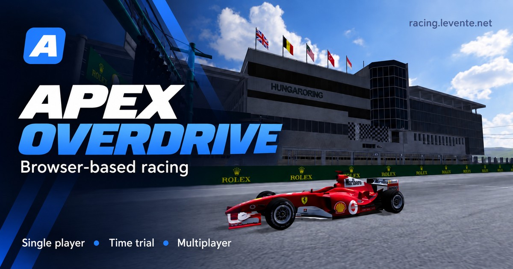

# Apex Overdrive



A browser-based racing game with real-world circuits and cars. Built with
Three.js rendering, Rapier physics, a Node.js server, WebSocket multiplayer
and an optional MySQL/MariaDB leaderboard.

The growing asset library includes more than **270 cars** and **25 tracks**
across six environments. The menu reads a server-generated asset manifest
rather than a hardcoded list, so newly added models appear automatically.

Exact counts are deliberately omitted because the library changes frequently.
Run `npm run verify:assets` to see the current totals.

## Getting started

Requires Node.js 20 or later.

```bash
npm install
npm start
```

Open **http://localhost:3000** to play.

For development with automatic server restarts:

```bash
npm run dev
```

Apache and PHP are not required locally: the same Node.js process serves
static files, the REST API and WebSocket connections.

MySQL/MariaDB is optional. When available, the server creates the required
tables and persists players, lap times, race results and ghost laps. The game
also starts without a database, but those records are not retained. Copy
`.env.example` to `.env` to configure the connection.

Run the tests:

```bash
npm test
```

Validate the complete local asset library before deployment:

```bash
npm run verify:assets
```

This checks JSON files, consistency between car models and manifests,
compressed model size limits, wheel patterns, and the spawn points, gates,
zone maps and collision files of active tracks. Large models are excluded
from Git, so this command is expected to report missing assets in a fresh
clone without the complete asset library.

## Languages

Use the dropdown in the top-right corner of the menu to choose a language.
The selection is remembered between sessions.

Magyar · English · Deutsch · Español · Français · Italiano · Português ·
Nederlands · Polski · Čeština · Slovenčina · Slovenščina · Hrvatski · Srpski ·
Română · Русский · Українська · Türkçe · 日本語 · 简体中文 · 한국어

Translations live in `web/lang/<code>.json`, with exactly the same set of
keys in every language. HTML elements use `data-i18n` attributes to mark
translatable content. Language names are displayed in their own language,
without flags: flags represent countries rather than languages.

The test suite checks every translation for missing and extra keys.

## Game modes

### Single player

A standard race with a configurable lap count. Cross the start line and
checkpoints in order. Missing a checkpoint, leaving the track completely or
making certain invalid movements invalidates the current lap without
ending the race.

### Time trial

An endless Hot Lap mode with a dedicated time-trial spawn point. Choose a
ghost from the leaderboard before starting, or drive without one. At each
checkpoint, the delta compares your time with the selected ghost, or with
your previous lap when no ghost is selected.

The ghost does not participate in physics and cannot collide with your car.
It uses the same optimized model as multiplayer opponents, capped at 5 MB,
with smooth transparency rather than a dithered appearance. New ghost laps
are recorded at 20 Hz; older 10 Hz recordings remain playable.

### Multiplayer

Up to eight players can race in one room. Public rooms appear in the room
browser; private rooms require a six-digit code. The host chooses the track,
lap count and rules, then starts the race.

The countdown begins once all connected players have loaded, or after the
60-second loading timeout. A central notification names the players who are
still loading, then shows “Waiting for the start…” when everyone is ready.
A disconnected player cannot keep the others waiting indefinitely.

Cars collide by default. Optional **Ghost mode** disables car-to-car
collisions. After finishing, players automatically enter spectator mode and
can cycle through drivers still racing. The spectated car receives full
visual and audio updates even at a distance.

## Tire wear and pit stops

Tire wear can be enabled for single-player and multiplayer races. It is
inactive in time trials and one-lap races. Wear accumulates from the first
lap's checkpoints, with one set lasting roughly four complete laps. Worn
tires gradually lose longitudinal and lateral grip, but do not puncture or
invalidate a lap. Skipping checkpoints does not save tires: any unaccounted
wear for a completed lap is applied at the start line.

- Crossing the pit entry slows the car to a maximum of 100 km/h.
- Each grid position has a pit box with the same number.
- Stop continuously in your own pit box for three seconds.
- After three seconds, a fresh set of tires is fitted. Tires can be changed
  only once per pit-lane visit; the completion indicator remains until exit.
- Crossing the pit exit removes the speed limit.
- The HUD displays tire condition as a percentage, with persistent,
  increasingly prominent warnings at 60%, 40% and 20%.
- Pit stops are allowed on any lap and multiple times during a race.
- The rule is automatically disabled if the pit configuration is incomplete.

A complete pit configuration requires at least one entry, at least one exit
and exactly eight pit boxes. Multiple entry and exit lines are supported.

## Controls

- `W` / `↑`: accelerate
- `S` / `↓`: brake; reverse at low speed
- `A`, `D` / `←`, `→`: steer
- `Space`: handbrake
- `C`: change camera
- Right mouse button + drag: look around
- `R`: reset near the last valid checkpoint crossing
- `M`: mute
- `F9`: download the current multiplayer netcode report

`R` becomes available after the first start-line crossing. If the car crossed
the checkpoint on asphalt, it returns to that crossing position; otherwise,
it returns to the checkpoint center. The server recognizes this as an
allowed teleport, so using it does not itself invalidate the lap.

Mobile devices have separate steering, throttle and brake buttons.

## Architecture

```text
web/          public client and assets; served directly by Apache in production
server/       local static serving, REST API, WebSocket and race management
shared/       physics and rules shared by client and server
tools/        car analysis, wheel detection and model optimization tools
masters/cars/ non-public, full-quality source models for large cars
test/         Node.js test suite
```

The player's browser simulates the local car at a fixed 60 Hz, so steering
does not wait for a network response. Due physics steps run at the beginning
of each frame, with at most three catch-up steps. This prevents rendering
from starving a separate physics timer for 80–125 ms. When old time is
discarded, the entire presentation buffer timeline shifts together rather
than leaving a long gap in interpolation. The client sends its state at
30 Hz; the server validates movement, manages starts, checkpoints, laps,
pit stops, results and ghosts, and broadcasts snapshots at 20 Hz.

Remote cars use delayed, adaptive interpolation. Corrections, wheel
animation, audio and update frequency depend on distance, with the spectated
car always exempt from throttling. Detailed opponent models are warmed up
with actual GPU draw calls during loading. Poor frame times do not replace
the selected optimized car skin; a simple box fallback is used only when
the real model fails to load. Local main-thread stalls are excluded from
ping and snapshot-jitter estimates. After a long frame, render clocks reset
to the permitted buffer depth instead of leaving cars visibly delayed for
seconds or minutes.

Car-to-car collisions do not use movable remote Rapier bodies. Each client
resolves only its own car against shared F1 capsule hitboxes derived from
remote network poses. Swept collision checks prevent high-speed tunneling.
Contacts can modify only horizontal velocity and yaw; a separate shape
query against real track walls limits position corrections. This avoids
pushing a remote car into a wall and snapping it back on the next snapshot.

Server movement validation does not kick players: genuine violations
invalidate the current lap. Thresholds account for high-speed circuits,
packet bursts, brief ping spikes and legitimate resets.

Rooms live in memory because they change continuously and have no purpose
after a server restart. Only persistent records are stored in the database.

### Line endings

The repository uses **LF** line endings, enforced on every platform by
`.gitattributes` (`* text=auto eol=lf`). Git for Windows commonly sets
`core.autocrlf=true`, which stores LF in Git but checks files out with CRLF.
This made editors that write LF immediately report changes and caused
some source-pattern-based tests to fail in fresh clones. The project runs
on Linux and has no Windows-specific scripts.

Tracked binary formats (`*.png`, `*.glb`, `*.bin`, `*.hdr`, `*.exe`) are
explicitly marked as `binary` in `.gitattributes`. Git would usually detect
them through its NUL-byte heuristic, but explicit rules help prevent silent
binary corruption.

## Testing network latency

On localhost, simulate ping and jitter through URL parameters:

```text
http://localhost:3000/?lag=150&jitter=30
```

Values are full round-trip times in milliseconds. Inspect these diagnostics
in the browser console:

```text
__mp.pingMs
__mp.jitterMs
__mp.interpDelayMs
__mp.predDelayMs
__mp.snapshotTransitDropped
__mp.rawPos
__mp.interpPos
```

During multiplayer, the client keeps the last 30 seconds of ping, snapshots,
state sends, physics timing and frame data in a fixed-size ring buffer.
Press `F9` to download a JSON report containing those samples and recent
automatically retained incidents: ping spikes, main-thread stalls,
connection loss and server validation events.

The report includes the actual GPU, pixel ratio and rendering resolution,
plus metrics for snapshot backlogs, the local physics buffer and camera
recovery. A dedicated `visual_motion` entry separates visible jitter in the
local car, camera, camera-to-car motion, camera rotation and opponents within
80 meters. Remote cars follow the same displayed instant as the local car;
the report also records the shift relative to the previous stable network
timeline.

Reports do not include player names, room codes, login tokens or server
message text. File creation and JSON serialization happen only when `F9`
is pressed.

Graphics profiles control render resolution, shadows and the size of the
environment map generated at runtime from one original 4K HDR file. Low,
medium and high use 256-, 512- and 1024-pixel cubemap faces respectively.
The full HDR is kept only during loading and the initial GPU resize;
separate skybox files and persistent 4K environment textures are unnecessary.

### Local physics and possible next steps

F9 schema 10 reports showed that weaker integrated GPUs could still produce
frames while the previous separate `setTimeout` physics loop was starved
for 80–125 ms. Fixed 60 Hz steps now run through a frame-aligned scheduler.
This does not remove Rapier's processing cost or reduce model rendering
cost; it prevents local car state updates from being separately starved
while rendering continues.

F9 reports still measure physics-step duration and lateness, local
presentation-buffer underruns and camera lag separately. Visual
extrapolation for the local car is warranted only if new measurements show
regular underruns with the revised scheduler. Moving all physics into a
Web Worker would justify a large refactor only if Rapier itself places a
significant load on the main thread; blocked rendering would still prevent
new frames from appearing.

## Developer mode

The menu's developer-mode button opens a track editor with a free camera.

### Zones

Mark asphalt, runoff, optional invisible walls and smoothing regions using:

- A brush with an adjustable radius.
- Filled polygons drawn point by point.
- Automatic generation from track material analysis.

A **smoothing region** affects collision-mesh baking rather than driving
behavior directly. Asphalt smoothing is restricted to marked regions. With
no regions marked, it applies to all asphalt, which works for long, flat
sections but can remove important surface detail on banked ovals.

Real walls and fences are primarily handled by `collision.bin`, baked from
the track model. Wall zones provide extra barriers where suitable 3D
geometry is missing; a track using few wall zones is not necessarily
misconfigured.

### Spawn points, gates and pit lane

- Place and rotate up to eight regular grid positions.
- Set a separate time-trial spawn point; without one, the eighth regular
  grid position is used.
- Select, move, resize and rotate the start line and existing checkpoints.
- Draw a guide line for automatic checkpoint generation.
- Edit multiple pit entries and exits, plus eight numbered pit boxes.

### Collision mesh

The collision-baking action creates `collision.bin` from track geometry.
This is required for multiplayer, where the server and every client use
the same collision mesh. Baking can filter small debris, smooth curbs and
exclude high tree canopies.

### Object cutter

Downloaded track models often contain unwanted objects, such as placeholder
boxes on the grid or floating debris. In **Object cutter** mode, clicking
selects and cuts the connected component rather than the entire mesh.

Cutting replaces triangles with degenerate triangles: all three indices
point to the same vertex, leaving no surface for the GPU to draw. Buffer
length stays unchanged, allowing the GLB to be patched in place without
re-encoding or changing textures, extensions or offsets. Saving returns
the modified model through a browser download.

Rebake the collision mesh after cutting. Some removed boxes may already
have been excluded by the debris filter because they were disconnected
components.

### Car wheel tester

Preview a stationary car with spinning and steering wheels. In this tool,
`W`/`S` and the up/down arrows cycle through cars; these keys do not change
the selected car in the normal menu.

## Processing cars

Automatic processing of new cars is split into several steps.

### Optimizing player models

```bash
npm run cars:optimize
```

Original models larger than 20 MB are preserved in the non-public
`masters/cars/` directory and optimized into player models capped at 15 MB.
Smaller cars are not duplicated unnecessarily.

### Multiplayer and ghost models

```bash
npm run cars:compress
```

Creates a version of every car capped at 5 MB in
`web/assets/cars/compressed/`. If a master exists, processing starts from
that source rather than the already optimized player model. These versions
are used for multiplayer opponents and time-trial ghosts.

Regenerate one car:

```bash
npm run cars:compress -- 2008_bmw_sauber_f1.08 --force
```

### Wheel configurations

```bash
npm run cars:wheels
```

Generates missing `wheelPattern` configurations while preserving manual
corrections. Force a fresh analysis of one car:

```bash
npm run cars:wheels -- 2024_ford_mustang_gt3 --force
```

Check the result in the developer wheel tester. See
[tools/README.md](tools/README.md) for the algorithm and additional options.

## Adding a track

Each track lives in `web/assets/maps/<track-id>/`. A complete configuration
usually contains:

```text
<track-id>.glb       visible track model
collision.bin        baked physics geometry
spawn.json           up to eight grid positions
hotlap_spawn.json    dedicated time-trial spawn point
gates.json           start line and checkpoints
pit.json             pit entries, exits and eight pit boxes
zonemap.png          asphalt/runoff/wall map
zonemap.json         zone-map coordinates
bake.json            collision-baking settings
```

JSON and PNG files are tracked in Git. Large `*.glb` and `*.bin` files are
excluded, so upload them separately to the corresponding server directory
when deploying a new track. Restart the Node.js service afterward because
the asset manifest is cached.

## Production deployment

Run Node.js as a systemd service behind Apache. Apache handles HTTPS,
serves static files directly and proxies API/WebSocket requests to Node.js.
See [DEPLOY.md](DEPLOY.md) for the general setup, environment variables,
permissions, asset uploads, updates and troubleshooting.

Server-code changes generally require a Git pull and a restart of the
`racing` service. Upload new or modified Git-ignored assets separately:
Git pull does not transfer large GLB, BIN, HDR or other model files.

## Current limitations

- Track models are large, currently around 40–195 MB, so loading a new track
  for the first time can be slow. Content-versioned URLs and a one-year
  browser cache make subsequent loads considerably faster.
- Local car physics runs on the client, so two players can briefly see
  different outcomes during car-to-car contact. The server still validates
  race rules and results authoritatively.

## License

Copyright © 2026 Levente Szabó (szabolevi98).

The project's original source code is licensed under the **GNU Affero
General Public License, Version 3** (`AGPL-3.0-only`). See [LICENSE](LICENSE)
for the full license text.

If you make a modified version available to users over a network, you must
prominently offer those users free access to the complete corresponding
source code of that version, as required by Section 13 of the license.
The game menu includes a direct
[source code link](https://github.com/szabolevi98/apex-overdrive).
Play at [racing.levente.net](https://racing.levente.net).

Third-party libraries and car, track and environment models remain subject
to their respective licenses and terms of use.
